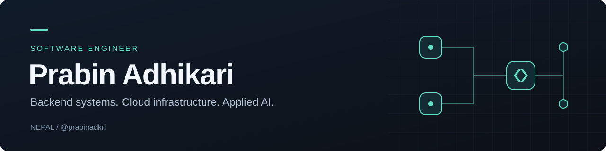

  <a href="https://www.linkedin.com/in/prabin-adhikari-5088b6238/">LinkedIn</a> &nbsp; · &nbsp;
  <a href="https://doi.org/10.1109/ACCESS.2026.3733686">IEEE Access publication</a> &nbsp; · &nbsp;
  <a href="https://cp.certmetrics.com/amazon/en/public/verify/credential/b028a939954741c4b27ca1a40d8fa459">AWS certification</a>

I’m a software engineer from Nepal and a Computer Engineering graduate of **IOE Pulchowk Campus, Tribhuvan University**. I build backend services, operate cloud infrastructure, and work on AI systems whose outputs can be checked against evidence.

My work spans the full path from API and database design to integrations, deployment and production troubleshooting. I also enjoy going a layer deeper: implementing a TCP data store in C++, studying event-driven systems, and evaluating language models beyond a single headline score.

## What I work on

- **Wholyx · Software Engineer, Cloud & Backend** — End-to-end engineering across backend services, AWS infrastructure, document workflows, third-party integrations and AI features. My work includes Node.js, Python, PostgreSQL, infrastructure as code and container delivery.
- **LOCUS · Former Backend Lead** — Led backend development for event platforms serving 2,000+ users, including REST APIs, authentication and database design.
- **Applied AI research** — Co-authored work on verifiable legal-contract question answering, combining retrieval, language-model fine-tuning, natural language inference and knowledge graphs.

## Selected work

### [Bhoklagyo · Food ordering & restaurant management](https://github.com/prabinadkri/Bhoklagyo)
Spring Boot backend with PostgreSQL/PostGIS search, Redis caching, Kafka events and real-time order updates. Includes Docker and Kubernetes configuration, observability and k6 load-test scripts.

**Java · Spring Boot · PostgreSQL · Kafka · Redis · Kubernetes**  
[Backend](https://github.com/prabinadkri/Bhoklagyo) · [Frontend](https://github.com/prabinadkri/Bhoklagyo_frontend)

### [Redis-like data store · Systems programming in C++](https://github.com/prabinadkri/Redis)
An in-memory key-value server built around TCP, an epoll event loop and RESP parsing, with TTL expiration, LRU eviction and persistence snapshots. A project in understanding how storage and networking fit together.

**C++17 · Linux · TCP · Data structures**

### [Coding Hub · A workspace for coding agents](https://github.com/prabinadkri/coding-hub)
Terminal, native Linux and web interfaces for cloud coding agents and local Ollama models, with project organization and conversation history.

**Python · Linux · Developer tooling · Local models**

### [Constraint-Preserving Liver World Model](https://github.com/prabinadkri/digital-liver-world-model)
A research prototype comparing two forecasting objectives through a constrained state integrator. Includes reproducible synthetic data, checkpoints, evaluation and failure analysis; it is a synthetic-data experiment, not a clinical tool.

**Python · Machine learning · Reproducible evaluation**

## Research

**[Verifiable Legal Contract Question Answering Using Natural Language Inference Grounding and Knowledge Graphs](https://doi.org/10.1109/ACCESS.2026.3733686)**  
Co-author · *IEEE Access*, 2026

The project combines clause-level retrieval, a fine-tuned Qwen model, neural verification and symbolic checks. My work includes LoRA/SFT/GRPO training, NLI data preparation and verifier development, and contract knowledge graphs.

## Tools I use

| Area | Technologies |
| :--- | :--- |
| Languages | Python, Java, C++, JavaScript/TypeScript, SQL |
| Backend & data | Spring Boot, Node.js, Express, FastAPI, Prisma, PostgreSQL, PostGIS, MongoDB, Redis, Kafka |
| Cloud & delivery | AWS, Docker, Kubernetes, OpenTofu/Terraform, GitHub Actions, Caddy, Sentry, Prometheus, Grafana |
| AI & ML | PyTorch, Hugging Face, scikit-learn, FAISS, RAG, LoRA/PEFT, natural language inference |

## Recognition & learning

- **AWS Certified Solutions Architect – Associate** · [Verify credential](https://cp.certmetrics.com/amazon/en/public/verify/credential/b028a939954741c4b27ca1a40d8fa459)
- **IEEEXtreme 2024** · Third place in Nepal, team competition
- **UXCam CodeCamp, LOCUS 2022** · Best Idea Award
- **International Mathematics Olympiad, 2020** · Participant
- **IOAA Global Astronomy and Astrophysics e-Competition, 2020** · Participant

More projects and coursework

### Additional project experience

- **FaceTag** — Face recognition, scene classification and natural-language photo search, served through FastAPI with MongoDB metadata.
- **Pattern Variation Generation** — Textile-design experiments using ControlNet and IP-Adapter conditioning.
- **Network Intrusion Detection** — Traffic analysis, anomaly detection and role-based access to the application.

### Courses

- Samsung Innovation Campus — Artificial Intelligence
- Generative AI — IOE Pulchowk Campus elective
- [Machine Learning Specialization — DeepLearning.AI / Stanford](https://coursera.org/share/97fce450c377a52ad253aa694f181ca1)
- [Microdegree in Artificial Intelligence](https://verifycertificates.fuseclassroom.com/?certificateId=694b9e73053262715baccf8b)
- [Google Data Analytics](https://coursera.org/share/041bc21c210c40a5962de4f65a23bc59)
- Jr Penetration Tester — TryHackMe

---

Interested in backend engineering, cloud infrastructure or applied AI? [Let’s connect on LinkedIn.](https://www.linkedin.com/in/prabin-adhikari-5088b6238/)
